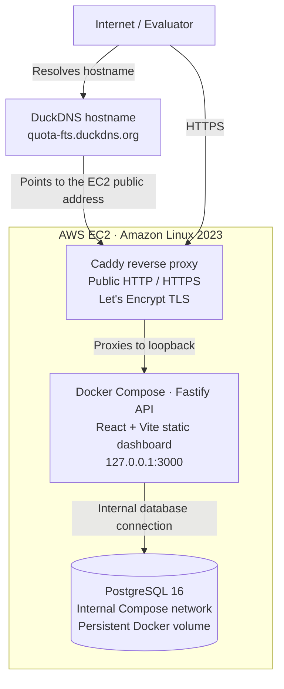

# Usage Metering & Quota Service

A cloud-hosted, account-aware quota service that makes atomic usage decisions across organization and user limits, with concurrency safety, idempotency, and an auditable request history.

[](https://aws.amazon.com/ec2/)
[](https://quota-fts.duckdns.org)

[](https://www.docker.com/)
[](https://www.postgresql.org/)
[](https://www.typescriptlang.org/)
[](https://fastify.dev/)
[](https://quota-fts.duckdns.org)

### 🚀 Live on AWS — Production-Style Cloud Deployment

This is a real, publicly accessible engineering demo hosted on Amazon EC2—not a mockup or localhost-only presentation. It uses a compact production-style deployment while deliberately avoiding claims of enterprise-scale operations or hardening.

| Deployment area | Live implementation |
| --- | --- |
| Cloud provider | Amazon Web Services (AWS) |
| Compute | Amazon EC2 running Amazon Linux 2023 |
| Containerization | Docker and Docker Compose |
| Application | Node.js, TypeScript, Fastify, and a built React + Vite dashboard |
| Database | PostgreSQL 16 with a persistent Docker volume |
| Public edge | Caddy reverse proxy with a Let's Encrypt TLS certificate |
| Hostname | DuckDNS |
| Availability | Publicly accessible live demo; no uptime guarantee is implied |

### Live Application

**URL:** [https://quota-fts.duckdns.org](https://quota-fts.duckdns.org)

[](https://quota-fts.duckdns.org)

### Try the Live Demo

Treat the API key issued during onboarding as a secret. The evaluator flow is:

1. Create an account and receive its one-time API key.
2. Create a user owned by that account.
3. Assign predefined plans or create custom monthly quota plans.
4. Consume usage units through the dashboard or REST API.
5. Inspect accepted and rejected decisions, monthly counters, and history.

Useful engineering scenarios to exercise include account-level and per-user enforcement, atomic all-or-nothing consumption, idempotent retries, over-limit rejection, plan changes, custom plans, usage history, and cross-account isolation.

### 🛠️ Engineering Highlights

- **Transaction-safe quota consumption:** PostgreSQL commits counters and decision history atomically.
- **Concurrency-safe accounting:** deterministic row locking prevents overlapping requests from overspending shared quotas.
- **Idempotent requests:** account-scoped request IDs replay the original decision without double charging.
- **Multi-tenant isolation:** authenticated account context scopes users, plans, counters, and history.
- **Two-level quota policy:** account and user monthly allowances and per-request ceilings are evaluated together.
- **Flexible plans:** seeded global plans and tenant-owned custom plans support both scopes.
- **Secure API-key handling:** raw keys are returned once; only SHA-256 hashes are stored.
- **Validated REST API:** Fastify routes use Zod validation and generic client-safe errors.
- **Database-backed verification:** real PostgreSQL integration tests cover persistence, concurrency, and rollback behavior.
- **Measured workloads:** k6 profiles exercise performance, quota concurrency, and idempotent retries.
- **Cloud delivery:** Docker Compose runs on AWS EC2 behind Caddy-managed HTTPS.

<a id="cloud-infrastructure-deployment"></a>

## ☁️ Cloud Infrastructure & Deployment

The live demo runs on an AWS EC2 instance using Amazon Linux 2023. Docker Compose orchestrates the Fastify application and PostgreSQL 16 containers. Fastify serves both the REST API and the compiled React dashboard, while PostgreSQL retains state in a named Docker volume.

Caddy runs at the public edge as the reverse proxy for the DuckDNS hostname and provisions the TLS certificate through Let's Encrypt. The live host exposes HTTP/HTTPS for browser traffic, forwards application traffic to the API on `127.0.0.1:3000`, and does not publish PostgreSQL port `5432` publicly. Docker restart policies restore the API and database containers after routine host or process restarts.



This is a production-style single-host deployment, not an enterprise production platform. It does not claim Kubernetes, ECS, RDS, load balancing, autoscaling, automated backups, CI/CD deployment, or production monitoring. Caddy is part of the live host configuration rather than an additional service in the repository's default Compose file. The repository's default host-port mapping remains convenient for local development; a public deployment must pair the loopback binding with appropriately restricted EC2 security-group and host-firewall rules.

## Project Demo

> **Demo video placeholder**
>
> [Watch the Demo](YOUR_DEMO_VIDEO_URL)
>
> Replace `YOUR_DEMO_VIDEO_URL` after recording the walkthrough. The planned video will demonstrate account onboarding, API-key authentication, user and plan management, accepted and rejected consumption, idempotent retries, and usage history.

## Contents

- [Cloud infrastructure & deployment](#cloud-infrastructure-deployment)
- [Overview](#overview)
- [Features and capabilities](#features-and-capabilities)
- [Architecture](#architecture)
- [Engineering decisions and technology trade-offs](#engineering-decisions-and-technology-trade-offs)
- [Quota model](#quota-model)
- [Concurrency and transaction design](#concurrency-and-transaction-design)
- [Idempotency](#idempotency)
- [Database design](#database-design)
- [Quick start](#quick-start)
- [Demo walkthrough](#demo-walkthrough)
- [API reference](#api-reference)
- [Configuration and operations](#configuration-and-operations)
- [Docker and deployment](#docker-and-deployment)
- [Testing strategy](#testing-strategy)
- [Performance benchmarks](#performance-benchmarks)
- [Security and reliability](#security-and-reliability)
- [Known limitations and future improvements](#known-limitations-and-future-improvements)
- [Repository structure](#repository-structure)

## Overview

Consider a document-processing SaaS. The organization buys a monthly processing allowance, while each of its users also has an individual allowance. Before processing a document, the application asks this service to consume a number of units. A valid decision must satisfy the account's current plan, the user's current plan, both per-request limits, and both monthly limits.

Centralizing that decision prevents every product service from implementing subtly different quota rules. It also creates one account-scoped audit trail for accepted and rejected requests.

Correctness is the central engineering problem. Two requests can observe the same remaining balance, retries can arrive after a timeout, and plan changes can overlap consumption. A naive read-check-write sequence could accept more usage than the plan permits or charge the same operation twice. This service addresses those risks with PostgreSQL transactions, a consistent row-lock order, database constraints, and account-scoped idempotency.

The implemented guarantees are:

- account and user quotas are evaluated together;
- an accepted decision increments both counters or neither;
- a business rejection increments neither counter but remains auditable;
- concurrent requests serialize before changing monthly counters;
- a repeated `requestId` and identical payload return the stored decision;
- conflicting reuse of a `requestId` returns `409 Conflict`;
- plan mutations and consumption share the account lock, producing a defined serialization order;
- every protected lookup is derived from the authenticated account, not a client-supplied account ID.

## Features and capabilities

| Area | Implemented behavior |
| --- | --- |
| Account onboarding | Creates an account on the predefined `Starter` ACCOUNT plan and issues one API key in the same transaction. |
| API-key security | Generates cryptographically random keys, stores only SHA-256 hashes and non-secret prefixes, and rejects missing, invalid, or revoked keys. |
| User registration | Creates tenant-scoped external users on the predefined `Basic` USER plan. |
| Plans | Provides seeded global plans plus account-owned custom ACCOUNT and USER plans. Predefined plans are read-only. |
| Plan changes | Changes account or user plan assignments and updates custom plan limits without resetting usage. |
| Quota policy | Enforces account and user monthly allowances plus maximum units per request. |
| Monthly accounting | Uses UTC calendar months and creates counters lazily for the active month. |
| Consumption | Returns an accepted or rejected business decision from one PostgreSQL transaction. |
| Idempotency | Stores decisions by `(account_id, request_id)` and safely replays identical requests. |
| Multi-tenancy | Scopes users, custom plans, usage, and history to the account resolved from `X-API-Key`. |
| Reporting | Exposes current account/user usage and paginated, filterable request history. |
| Demo client | Serves a React and Vite dashboard as static files from Fastify. |
| Operations | Provides a multi-stage production image, Compose healthchecks, persistent PostgreSQL storage, and log rotation. |
| Verification | Includes PostgreSQL integration tests, deterministic plan-change tests, static-path security regression tests, and k6 profiles. |

Implemented behavior is described in this README. Ideas under [Known limitations and future improvements](#known-limitations-and-future-improvements) are not implemented commitments.

## Architecture

The repository's Compose topology has two services: one Fastify container and one PostgreSQL 16 container. The React client is built into `dist/public` and served by Fastify, so browser traffic and API traffic use the same origin. The live EC2 host adds Caddy as an external reverse proxy; Caddy is not a third service in the repository's default Compose file.

At request time:

1. Fastify routes the request.
2. Zod validates route input at the HTTP boundary.
3. Protected routes hash `X-API-Key`, load the key and account, and attach the account to the request.
4. Thin route handlers call account, user, plan, or usage services.
5. Drizzle issues SQL through a shared `pg.Pool`.
6. PostgreSQL enforces durability, ownership relationships, uniqueness, and transaction serialization.

### High-Level System Architecture

> **Planned visual - not yet implemented**
>
> `[ARCHITECTURE DIAGRAM — TO BE ADDED]`
>
> This diagram will illustrate the calling application and browser dashboard, Fastify routing, authentication and validation, quota services, Drizzle/`pg`, and PostgreSQL. It will also show that Fastify serves the compiled React application rather than running a separate frontend service.
>
> Future asset: `docs/assets/system-architecture.png`

## Engineering Decisions and Technology Trade-offs

The stack deliberately favors one understandable transactional system over distributed infrastructure that would add coordination work before it adds product value.

| Choice | Why it fits this service | Alternatives considered | Main cost |
| --- | --- | --- | --- |
| TypeScript | Keeps route inputs, service contracts, and database results explicit across a growing backend. | JavaScript | Types disappear at runtime and do not replace validation or tests. |
| Fastify | Provides a small HTTP core, async hooks, plugins, injection testing, and low framework overhead. | Express, NestJS | Smaller conventions layer than NestJS; architecture must be maintained by the project. |
| PostgreSQL | Makes quota counters, decisions, uniqueness, and row locking part of one durable transaction. | Redis, MongoDB | Lock contention and relational schema evolution require deliberate design. |
| Drizzle ORM | Preserves typed queries while keeping SQL operations such as `FOR UPDATE` visible. | Prisma, raw SQL | Less abstraction than Prisma, but still another API to understand. |
| Zod | Validates untrusted HTTP input at runtime and derives TypeScript types from the same schemas. | Manual validation, JSON Schema-only validation | Adds schemas beside TypeScript types and does not validate database state. |
| React + Vite | Provides an evaluator-friendly dashboard and a fast static build with no production frontend process. | Server-rendered pages, a separate SPA deployment | Couples the demo release to the API image and keeps the raw key in browser session state. |
| Docker Compose | Reproduces API/database startup, health ordering, migrations, seeding, networking, and persistence in one command. | Manual setup, Kubernetes | Compose is single-host orchestration, not a production scheduler. |
| k6 | Generates concurrent HTTP traffic and exposes latency, throughput, and custom correctness metrics. | Ad hoc scripts, general unit-test runners | Results depend on the load generator and environment and are not capacity guarantees. |

### TypeScript

TypeScript is useful where database `bigint` values, nullable rejection fields, plan scopes, and authenticated request decoration must remain consistent across layers. It makes incompatible refactors visible during builds. Compile-time checks cannot prove that JSON input is valid, that two transactions serialize correctly, or that a deployment is secure; Zod, PostgreSQL constraints, and integration tests cover those boundaries.

### Fastify versus Express and NestJS

Fastify supplies lifecycle hooks and request injection without imposing a large application framework. That is appropriate for a focused service with four domain modules. Express would be familiar and flexible but would require more project-level choices for validation and plugin structure. NestJS offers strong conventions and dependency injection, but its additional abstraction and runtime footprint would not solve the core concurrency problem. No repository benchmark compares these frameworks, so the choice is based on fit rather than an unsupported speed claim.

### PostgreSQL versus Redis and MongoDB

PostgreSQL is the authoritative store because the same transaction can lock counters, evaluate current plans, update both usage levels, and persist the decision. Foreign keys, checks, composite uniqueness, and durable history reinforce application invariants.

Redis can perform atomic counter operations and could become a cache or accelerator at much higher scale. Making it authoritative would require a durable-history strategy and careful reconciliation with account, user, and plan data. MongoDB supports multi-document transactions, but this model is naturally relational and relies heavily on ownership joins, composite constraints, and deterministic row locking. One PostgreSQL database is simpler and sufficient for the current scope.

### Drizzle ORM versus Prisma and raw SQL

Drizzle provides schema-derived types without hiding important SQL behavior. The consumption service can express `FOR UPDATE`, conflict-safe inserts, and transactions directly. Prisma would provide a broader generated client and tooling ecosystem but adds another abstraction over lock-sensitive operations. Raw SQL would maximize control but increase mapping and type-maintenance work. Drizzle keeps the critical SQL model inspectable while avoiding most manual result typing.

### Zod

HTTP bodies, parameters, and queries are runtime data; TypeScript cannot validate them after compilation. Zod rejects empty identifiers, malformed UUIDs and months, unsupported scopes or statuses, unsafe numeric values, and unexpected fields on strict request bodies. Database constraints remain the final protection for cross-request invariants such as uniqueness.

### React and Vite

The dashboard makes quota state and rejection decisions inspectable without Postman or custom scripts. Vite supplies a compact development server and production static build. Serving that build through Fastify gives the demo one URL and one runtime container. The trade-off is deployment coupling: a frontend-only change rebuilds the API image, and this arrangement does not provide independent frontend scaling or CDN delivery.

### Docker Compose

Compose starts PostgreSQL, waits for its healthcheck, builds the client and server, applies migrations, seeds predefined plans, and then starts Fastify. The named volume preserves data across routine restarts. Kubernetes would add deployment, networking, secret, and health-management complexity without a multi-node requirement in this take-home scope.

### k6

k6 complements integration tests by creating overlapping requests and recording custom business metrics. The suite separates a valid quota rejection from a transport or server failure. Load tests answer how this implementation behaved under a recorded workload; concurrency profiles additionally assert correctness. Neither result substitutes for production capacity planning.

## Quota Model

Every consumption request evaluates four limits in this exact precedence:

1. account maximum units per request;
2. user maximum units per request;
3. account monthly allowance;
4. user monthly allowance.

The first failing rule becomes the persisted rejection reason. A rejection is a successful API decision (`HTTP 200` with `accepted: false`), not a technical failure.

Monthly counters are keyed by the first day of the UTC month. If a counter does not exist, consumption inserts a zero row before locking it. The reporting endpoints also treat a missing row as zero. Remaining quota is clamped to zero so a later plan reduction cannot produce a negative API value.

An accepted decision advances both the account and user counters. A rejected decision advances neither. There is no partial charging.

The seeded global plans are:

| Plan | Scope | Monthly allowance | Maximum per request |
| --- | --- | ---: | ---: |
| Starter | ACCOUNT | 10,000 | 100 |
| Pro | ACCOUNT | 100,000 | 1,000 |
| Basic | USER | 1,000 | 20 |
| Premium | USER | 10,000 | 200 |

Custom plans belong to one account. A plan is assignable only when its scope matches the target and it is either global (`owner_account_id IS NULL`) or owned by the authenticated account.

Plan changes update only `current_plan_id`; custom-plan edits update only mutable plan fields. Neither operation deletes, recreates, or resets monthly usage. Current usage endpoints combine existing counters with the current plan's limit, while history returns the limits and counters captured when each decision was made.

## Concurrency and Transaction Design

### Quota Consumption Transaction Flow

> **Planned visual - not yet implemented**
>
> `[TRANSACTION FLOW DIAGRAM — TO BE ADDED]`
>
> This diagram will show how authentication and validation occur before the transaction, followed by idempotency checks, account/user and monthly-counter locks, current plan reads, quota evaluation, accepted-only counter updates, decision persistence, and commit.
>
> Future asset: `docs/assets/quota-transaction-flow.png`

The actual `POST /usage/consume` order is important. Its UTC month is captured when the service begins handling the request, before the transaction and quota-lock wait. A request that starts before a UTC boundary and commits after it therefore remains attributed to its request-entry month:

1. API-key authentication resolves the account.
2. Zod validates `userId`, positive integer `units`, and `requestId`.
3. The service derives the current UTC month and starts a Drizzle transaction.
4. It finds the user by both authenticated account ID and external user ID.
5. It checks for an existing account-scoped decision before taking quota locks.
6. It locks the account row, then the user row with `FOR UPDATE`.
7. It creates missing account and user monthly rows with `ON CONFLICT DO NOTHING`.
8. It locks the account monthly row, then the user monthly row.
9. It checks idempotency again after serialization.
10. It loads the plans referenced by the locked account and user assignments.
11. It evaluates limits in the documented rejection order.
12. On acceptance only, it updates both monthly counters.
13. It inserts a `usage_requests` row containing the decision, plan-limit snapshots, and post-decision counter snapshots.
14. The transaction commits, then the formatted decision is returned.

All quota-affecting mutations start with the account lock. User plan switches then lock the user; account plan switches need only the account; custom plan updates lock their owner account. This common serialization point means a consume operation sees one coherent plan state: if the plan mutation commits first, consumption reads the new assignment or limits; if consumption holds the account lock first, it uses the prior committed plan. It does not combine old and new limit values.

### Why concurrent requests do not overspend

For a user with a 50-unit monthly allowance, consider 20 simultaneous requests of 10 units each. Every request eventually locks the same account and user counter rows. Only five transactions can observe and advance the user counter through 10, 20, 30, 40, and 50. The remaining transactions observe 50 after acquiring the lock and persist USER `MONTHLY_ALLOWANCE` rejections without changing either counter.

The tested outcome is:

| Attempted | Accepted | Rejected | Final account usage | Final user usage |
| ---: | ---: | ---: | ---: | ---: |
| 20 x 10 units | 5 | 15 | 50 | 50 |

This result follows from database serialization, not timing assumptions in application memory. It remains correct across multiple Node.js processes sharing the same PostgreSQL database.

## Idempotency

Clients provide `requestId` with each consumption attempt. The database makes `(account_id, request_id)` unique, allowing different accounts to use the same identifier while preventing duplicate decisions within one account.

An identical retry returns the original stored response, including its accepted/rejected state and usage snapshots, without incrementing counters. Reusing the identifier with another user or unit amount returns `409 Idempotency conflict`.

The second lookup after locks is essential for simultaneous retries. Requests can both miss the optimistic first lookup, but they serialize on the account lock. After the first transaction commits its decision, the waiting transaction rechecks and returns that decision instead of charging again. The unique constraint remains the final database-level protection.

### Idempotency & Concurrent Requests

> **Planned visual - not yet implemented**
>
> `[IDEMPOTENCY & CONCURRENCY DIAGRAM — TO BE ADDED]`
>
> This diagram will illustrate the optimistic lookup, account-level serialization, the post-lock lookup, one persisted logical decision, identical retry responses, and `409` handling for conflicting payloads.
>
> Future asset: `docs/assets/idempotency-concurrency.png`

## Database Design

PostgreSQL contains seven core tables. Plans and assignments describe current policy, monthly tables hold mutable counters, and usage requests preserve decisions. History is not reconstructed from current counters because plan changes and later requests would erase the context that produced an earlier decision.

### Database ERD (Entity Relationship Diagram)

> **Planned visual - not yet implemented**
>
> `[DATABASE ERD — TO BE ADDED]`
>
> This diagram will illustrate the seven core tables, their account/user/plan relationships, composite tenant foreign key, monthly counter keys, idempotency uniqueness, and important ownership and non-negative checks.
>
> Future asset: `docs/assets/database-erd.png`

| Table | Role | Important constraints and indexes |
| --- | --- | --- |
| `plans` | Global predefined plans and account-owned custom plans. | UUID primary key; non-negative limits; owner/predefined consistency check; unique predefined `(name, scope)` and custom `(owner_account_id, name, scope)` indexes. |
| `accounts` | Tenant root and current ACCOUNT plan assignment. | UUID primary key; required foreign key to `plans`. |
| `api_keys` | Authentication material for an account. | Unique 64-character SHA-256 hash; account and non-secret prefix indexes; nullable revocation and last-used timestamps. |
| `users` | External users scoped to an account and assigned a USER plan. | Unique `(account_id, external_user_id)` and `(account_id, id)` constraints. |
| `account_monthly_usage` | One mutable account counter per UTC month. | Composite primary key `(account_id, month_start)`; non-negative units; first-day-of-month check. |
| `user_monthly_usage` | One mutable user counter per UTC month. | Composite primary key `(user_id, month_start)`; non-negative units; first-day-of-month check. |
| `usage_requests` | Persisted accepted/rejected decisions and snapshots. | Unique `(account_id, request_id)`; positive units; rejection consistency; non-negative snapshots; composite `(account_id, user_id)` tenant foreign key; account, user, and month indexes. |

The composite foreign key from `usage_requests(account_id, user_id)` to `users(account_id, id)` makes cross-account history associations invalid at the database layer. Service queries add account predicates as the first isolation boundary.

PostgreSQL `BIGINT` is mapped to JavaScript `bigint` inside the data layer. API serializers convert quota, usage, and remaining values to decimal strings so JSON never loses integer precision.

## Quick Start

### Requirements

- Docker with Docker Compose v2
- An available host port, `3000` by default

No local Node.js installation or `.env` file is required for the Compose path.

### Start everything

```bash
docker compose up --build
```

Compose starts PostgreSQL, waits until it is healthy, applies committed migrations, idempotently seeds predefined plans, and starts the API. The same Fastify process serves the React dashboard.

- Demo: `http://localhost:3000`
- Health: `http://localhost:3000/health`

Check health from a shell:

```bash
curl http://localhost:3000/health
```

Or from Windows PowerShell:

```powershell
Invoke-RestMethod http://localhost:3000/health
```

Expected response:

```json
{"status":"ok"}
```

### Stop safely

```bash
docker compose down
```

The named `postgres_data` volume survives routine stops and `docker compose down`.

> **Data-loss warning:** do not add `--volumes` or `-v` unless you intentionally want to delete the PostgreSQL data volume.

### Local development

To run Node.js outside Docker, install dependencies, copy the example environment, provide a PostgreSQL instance reachable through `DATABASE_URL`, and start the server:

```bash
npm ci
cp .env.example .env
npm run db:migrate
npm run db:seed
npm run dev
```

Windows PowerShell:

```powershell
npm.cmd ci
Copy-Item .env.example .env
npm.cmd run db:migrate
npm.cmd run db:seed
npm.cmd run dev
```

The current Compose PostgreSQL service is internal to the Compose network and is not published to the host. Use the all-Docker quick start or point `DATABASE_URL` at a separately reachable development database.

For separate frontend development, run `npm run dev:client`; Vite serves `http://localhost:5173` and proxies API routes to `http://127.0.0.1:3000`.

## Demo Walkthrough

1. **Create an account.** Open the dashboard and create an account. It starts on Starter, and the raw API key is shown once. This establishes the tenant and its initial account policy.
2. **Copy the API key.** Save the key before dismissing the dialog. The database stores only its hash, so the service cannot recover it later.
3. **Create a user.** Add `user_001`. The authenticated account is taken from the key; the form cannot choose another tenant. The user starts on Basic.
4. **Inspect plans.** Compare global ACCOUNT/USER plans and create an account-owned custom plan if desired. Predefined plans remain read-only.
5. **Submit accepted consumption.** In the playground, send 10 units for `user_001` with a unique request ID. Both account and user counters advance together if all four checks pass.
6. **Submit rejected consumption.** On Basic, a request above 20 units violates the user's per-request limit. The decision is stored, but counters do not change.
7. **Retry the accepted request.** Reuse the exact request ID, user, and units. The original decision is returned with no second charge.
8. **Change a plan.** Assign another compatible plan and observe that previously consumed units remain. Future decisions use the plan effective at their serialization point.
9. **Review history.** Filter accepted and rejected requests and inspect their stored post-decision snapshots.

For evaluator convenience, the dashboard stores the active API key and recently used user identifiers in browser `sessionStorage`. It sends the key only through `X-API-Key`; this demo-oriented browser storage is not presented as production identity or secret management.

## API Reference

### Authentication and conventions

Except for `GET /health` and `POST /accounts`, endpoints require:

```http
X-API-Key: uq_live_<prefix>_<secret>
```

Missing, invalid, and revoked keys return:

```json
{"error":"Unauthorized"}
```

The server never accepts `accountId` in tenant-scoped request bodies. Numeric `BIGINT` fields are returned as decimal strings.

### Endpoint summary

| Method | Path | Auth | Purpose | Important responses |
| --- | --- | --- | --- | --- |
| `GET` | `/health` | Public | Process health response. | `200`; no database readiness query. |
| `POST` | `/accounts` | Public | Create an account on Starter and issue its initial key. | `201`, `400`, `500`. |
| `GET` | `/me` | API key | Return the authenticated account ID and name. | `200`, `401`, `500`. |
| `PATCH` | `/account/plan` | API key | Assign an accessible ACCOUNT plan to the caller. | `200`, `400`, `401`, `404`, `500`. |
| `POST` | `/users` | API key | Create an external user on Basic under the caller. | `201`, `400`, `401`, `409`, `500`. |
| `PATCH` | `/users/:externalUserId/plan` | API key | Assign an accessible USER plan to the caller's user. | `200`, `400`, `401`, `404`, `500`. |
| `POST` | `/plans` | API key | Create an account-owned custom plan. | `201`, `400`, `401`, `409`, `500`. |
| `GET` | `/plans` | API key | List global plans and the caller's custom plans. | `200`, `401`, `500`. |
| `PATCH` | `/plans/:planId` | API key | Update mutable fields on an owned custom plan. | `200`, `400`, `401`, `403`, `404`, `409`, `500`. |
| `POST` | `/usage/consume` | API key | Atomically decide and persist a quota request. | `200`, `400`, `401`, `404`, `409`, `500`. |
| `GET` | `/usage/account` | API key | Read account usage for a UTC month. | `200`, `400`, `401`, `500`. |
| `GET` | `/usage/users/:externalUserId` | API key | Read one owned user's usage for a UTC month. | `200`, `400`, `401`, `404`, `500`. |
| `GET` | `/usage/history` | API key | Page and filter the caller's decision history. | `200`, `400`, `401`, `500`. |

### Accounts and authentication

Create an account:

```http
POST /accounts
Content-Type: application/json

{"name":"DocuApp"}
```

```json
{
  "account": {
    "id": "<uuid>",
    "name": "DocuApp",
    "plan": {"id":"<uuid>","name":"Starter"}
  },
  "apiKey": "uq_live_<returned-once>"
}
```

The name is trimmed and must not be empty. Account creation and hashed API-key persistence share one transaction.

`GET /me` returns:

```json
{"account":{"id":"<uuid>","name":"DocuApp"}}
```

Change the authenticated account's plan:

```http
PATCH /account/plan
X-API-Key: <key>
Content-Type: application/json

{"planId":"<account-plan-uuid>"}
```

A USER-scoped plan returns `400`; an absent, foreign-owned, or inaccessible plan returns `404`.

### Users

```http
POST /users
X-API-Key: <key>
Content-Type: application/json

{"externalUserId":"user_001"}
```

```json
{
  "user": {
    "id": "<uuid>",
    "externalUserId": "user_001",
    "plan": {"id":"<uuid>","name":"Basic"}
  }
}
```

The identifier is unique within one account. A duplicate returns `409 User already exists`; the same identifier is allowed in another account.

Change a user's plan:

```http
PATCH /users/user_001/plan
X-API-Key: <key>
Content-Type: application/json

{"planId":"<user-plan-uuid>"}
```

The user lookup always includes the authenticated account ID. Foreign users and inaccessible plans return the same `404 Not found` shape.

### Plans

Create a custom plan:

```http
POST /plans
X-API-Key: <key>
Content-Type: application/json

{
  "name": "Gold",
  "scope": "USER",
  "monthlyAllowance": 5000,
  "maxUnitsPerRequest": 100
}
```

```json
{
  "plan": {
    "id": "<uuid>",
    "name": "Gold",
    "scope": "USER",
    "monthlyAllowance": "5000",
    "maxUnitsPerRequest": "100",
    "isPredefined": false
  }
}
```

Limits must be non-negative safe integers. Ownership and `isPredefined: false` come from the server. Duplicate `(owner, name, scope)` values return `409 Plan already exists`.

`GET /plans` returns:

```json
{
  "plans": [
    {
      "id": "<uuid>",
      "name": "Basic",
      "scope": "USER",
      "monthlyAllowance": "1000",
      "maxUnitsPerRequest": "20",
      "isPredefined": true
    }
  ]
}
```

Update an owned custom plan:

```http
PATCH /plans/<planId>
X-API-Key: <key>
Content-Type: application/json

{"name":"Gold Plus","monthlyAllowance":7500,"maxUnitsPerRequest":150}
```

At least one mutable field is required. `scope`, ownership, and predefined status cannot be changed. Updating a predefined plan returns `403`; another account's plan appears inaccessible and returns `404`.

### Consumption

```http
POST /usage/consume
X-API-Key: <key>
Content-Type: application/json

{"userId":"user_001","units":10,"requestId":"document_0001"}
```

Accepted decision:

```json
{
  "accepted": true,
  "requestId": "document_0001",
  "units": "10",
  "account": {"used":"10","remaining":"9990"},
  "user": {"used":"10","remaining":"990"}
}
```

Rejected decision:

```json
{
  "accepted": false,
  "requestId": "document_0002",
  "units": "25",
  "account": {"used":"10","remaining":"9990"},
  "user": {"used":"10","remaining":"990"},
  "rejection": {"scope":"USER","rule":"MAX_UNITS_PER_REQUEST"}
}
```

Valid rejection rules are `MAX_UNITS_PER_REQUEST` and `MONTHLY_ALLOWANCE`; scopes are `ACCOUNT` and `USER`. An unknown account-scoped user returns `404`. Conflicting idempotency input returns `409`.

### Usage reporting and history

Account usage, optionally for `month=YYYY-MM`:

```http
GET /usage/account?month=2026-10
X-API-Key: <key>
```

```json
{
  "accountId": "<uuid>",
  "month": "2026-10",
  "used": "10",
  "monthlyLimit": "10000",
  "remaining": "9990"
}
```

User usage follows the same convention:

```http
GET /usage/users/user_001?month=2026-10
X-API-Key: <key>
```

```json
{
  "externalUserId": "user_001",
  "month": "2026-10",
  "used": "10",
  "monthlyLimit": "1000",
  "remaining": "990"
}
```

Omit `month` to use the current UTC month. Missing counter rows return `used: "0"`.

History accepts `page` (default `1`), `limit` (default `20`, maximum `100`), `externalUserId`, `status=ACCEPTED|REJECTED`, and `month=YYYY-MM`:

```http
GET /usage/history?page=1&limit=20&status=ACCEPTED
X-API-Key: <key>
```

```json
{
  "items": [
    {
      "requestId": "document_0001",
      "externalUserId": "user_001",
      "units": "10",
      "status": "ACCEPTED",
      "rejection": null,
      "createdAt": "2026-10-15T12:00:00.000Z",
      "account": {"usedAfter":"10","remainingAfter":"9990"},
      "user": {"usedAfter":"10","remainingAfter":"990"}
    }
  ],
  "page": 1,
  "limit": 20,
  "total": 1
}
```

Results are newest first and always scoped to the authenticated account.

## Configuration and Operations

| Variable | Required/default | Purpose |
| --- | --- | --- |
| `DATABASE_URL` | Required by the Node.js process; Compose supplies an internal URL. | PostgreSQL connection string used by Drizzle and `pg`. |
| `DB_POOL_MAX` | `10` | Positive integer maximum for the shared PostgreSQL pool. |
| `PORT` | `3000` | API listen port; also controls the Compose host mapping. |
| `POSTGRES_DB` | `quota_db` in Compose | Database created by the PostgreSQL image. |
| `POSTGRES_USER` | `quota_user` in Compose | Development database role. |
| `POSTGRES_PASSWORD` | `quota_password` in Compose | Development-only database password. |
| `POSTGRES_PORT` | Present in `.env.example`; not consumed by the current Compose file. | Convention for a separately reachable local PostgreSQL instance. |

The pool validates `DB_POOL_MAX` and uses a 5-second connection timeout. `idleTimeoutMillis` is not overridden, so node-postgres retains its default behavior. Transaction isolation is not customized; correctness comes from explicit row locks, constraints, and transaction boundaries.

Operational behavior:

- PostgreSQL healthcheck: 5-second interval, 5-second timeout, 5 retries, 10-second startup grace.
- API healthcheck: 30-second interval, 5-second timeout, 5 retries, 10-second startup grace.
- Docker `json-file` logs rotate at 10 MiB with three files per service.
- The API health route returns process status only; it does not execute a database readiness query.
- `GET /health` has route-specific logging configuration while business endpoint logging remains enabled.

## Docker and Deployment

The Dockerfile uses three stages:

1. `server-build` installs development dependencies and compiles TypeScript.
2. `client-build` installs client dependencies and creates the Vite production bundle.
3. `runtime` installs production dependencies only, copies compiled server/client artifacts and migrations, and runs as the non-root `node` user.

Container startup applies migrations, seeds predefined plans, and then replaces the shell with the Node.js server. A migration or seed failure prevents the API from starting against incomplete state.

### Docker Deployment Architecture

> **Planned visual - not yet implemented**
>
> `[DOCKER DEPLOYMENT DIAGRAM — TO BE ADDED]`
>
> This diagram will place the compiled React static application inside the Fastify runtime container, show Fastify communicating with PostgreSQL over the Compose network, and identify the host port and persistent database volume.
>
> Future asset: `docs/assets/docker-deployment.png`

The repository's container topology is intentionally small. It has no Redis, proxy container, process manager, or Kubernetes configuration. The live EC2 host supplies Caddy at the network edge without changing the quota decision path, which remains dependent on one authoritative PostgreSQL database.

An observed post-test idle snapshot recorded approximately 37.95 MiB for the API and 30.96 MiB for PostgreSQL. Those values are observations from one local Docker environment, not proof that a specific optimization caused the memory level and not a production sizing recommendation.

## Testing Strategy

The integration tests use Fastify injection with real PostgreSQL state. They cover domain persistence rather than replacing database behavior with mocks.

| Command | Focus |
| --- | --- |
| `npm run test:accounts` | Starter assignment and one-time hashed API-key persistence. |
| `npm run test:auth` | Public routes, valid/invalid/revoked keys, and authenticated account context. |
| `npm run test:static-security` | React assets, API route precedence, and encoded/non-canonical path protection. |
| `npm run test:users` | Tenant-scoped user creation, duplicates, and cross-account identifiers. |
| `npm run test:user-plan` | User plan scope, access rules, assignment, and usage preservation. |
| `npm run test:plans` | Custom plan creation/list/update, ownership, validation, and predefined immutability. |
| `npm run test:account-plan` | Account plan assignment, access rules, and usage preservation. |
| `npm run test:usage` | Accepted/rejected consumption, counter atomicity, idempotency, isolation, and concurrency. |
| `npm run test:usage-read` | Monthly reads, history, pagination, filters, and account isolation. |
| `npm run test:plan-concurrency` | Deterministic serialization of consume, plan switches, and custom-plan updates. |
| `npm run test:quota-edge-cases` | UTC rollover attribution, concurrent idempotency conflicts, cross-user account contention, and transaction rollback. Requires an explicitly marked disposable database. |
| `npm run test:concurrency-manual` | Manual 10-request quota race against a running API. |

Install dependencies and build before focused checks:

```bash
npm ci
npm run build
npm run test:static-security
npm run test:usage
npm run test:plan-concurrency
```

These are independent scripts; the repository does not define one aggregate full-suite command. This README update did not execute backend integration tests or builds.

The standalone [k6 suite](load-tests/README.md) creates isolated fixtures through the real API and provides:

```powershell
.\load-tests\run-k6.ps1 smoke
.\load-tests\run-k6.ps1 load
.\load-tests\run-k6.ps1 concurrency
.\load-tests\run-k6.ps1 idempotency
.\load-tests\run-k6.ps1 stress
```

Stress is an explicit, controlled profile rather than part of normal application startup. Generated result JSON is intentionally ignored by Git, while [the checked-in results summary](load-tests/results/README.md) records retained evidence.

## Performance Benchmarks

### Measured Performance & Correctness

These profiles measure different workloads and must not be merged into one capacity number. HTTP totals include fixture setup and final verification requests where the k6 harness reports them.

| Profile | Workload | HTTP requests | RPS | Average | p95 | p99 | Technical failures |
| --- | --- | ---: | ---: | ---: | ---: | ---: | ---: |
| Smoke | 1 VU, 5 consume requests | 14 | 73.86 | 14.50 ms | 23.98 ms | 29.58 ms | 0 |
| Quota concurrency | 20 requests in one concurrent batch | 29 | 106.97 | 41.00 ms | 71.99 ms | 91.00 ms | 0 |
| Idempotency concurrency | 20 identical concurrent requests plus conflict check | 30 | 182.29 | 18.53 ms | 61.96 ms | 77.29 ms | 0 |
| Normal load | Ramp to 10 VUs, hold, ramp down | 1,795 | 35.77 | 26.16 ms | 116.32 ms | 217.69 ms | 0 |
| Controlled stress | Stages at 10, 25, and 50 VUs | 5,319 | 132.72 | 98.43 ms | 279.34 ms | 328.04 ms | 0 |

### Performance Visualization

> **Planned visual - not yet implemented**
>
> `[PERFORMANCE CHART — TO BE ADDED]`
>
> This chart will compare RPS and latency percentiles by profile without implying that the controlled-stress result is maximum capacity. The measured tables remain the source of truth until the visual is added.
>
> Future asset: `docs/assets/performance-chart.png`

Correctness evidence:

| Profile | Accepted/rejected behavior | Expected final usage | Actual account/user usage |
| --- | --- | ---: | ---: |
| Smoke | 5 accepted, 0 rejected | 10 | 10 / 10 |
| Quota concurrency | 5 accepted, 15 rejected | 50 | 50 / 50 |
| Idempotency concurrency | 20 identical accepted responses, one logical 7-unit charge, one expected conflict | 7 | 7 / 7 |
| Normal load | 1,786 accepted | 1,786 | 1,786 / 1,786 |
| Controlled stress | 5,310 accepted | 5,310 | 5,310 / 5,310 |

Interpretation:

- A **VU** is a k6 virtual user repeatedly executing a scenario.
- **RPS** is completed HTTP requests per second for that profile, including its setup and verification traffic.
- **Average latency** is the arithmetic mean and can hide tail behavior.
- **p95** and **p99** are the durations at or below which 95% and 99% of measured requests completed.
- A **business rejection** is a valid quota decision and is tracked separately from malformed responses, unexpected statuses, network errors, and other **technical failures**.
- More VUs can increase offered concurrency and throughput, while lock waits, database work, and generator limits can also increase latency.

All five profiles are retained as compact, sanitized JSON in the [verified results index](load-tests/results/README.md). Raw generated reports remain ignored; each committed summary records the selected source filename, its SHA-256 digest, the UTC execution time, full-precision measurements, correctness totals, and assertion verdict. The recorded environment was local Docker Compose with `grafana/k6:1.8.2`. Precise host hardware, Docker CPU allocation, generator utilization, and CPU saturation were not captured, so these numbers are reproducibility evidence for the stated workloads, not maximum system capacity or production sizing data.

## Security and Reliability

- **API keys:** account creation uses Node.js `randomBytes`; the raw key is returned once, while PostgreSQL stores only a SHA-256 hash and short non-secret prefix.
- **Authentication:** protected routes resolve an unrevoked key hash and attach only account ID and name to the request.
- **Tenant isolation:** user, plan, usage, and history queries include the authenticated account ID. Cross-account resources generally return not-found responses.
- **Validation:** Zod rejects malformed bodies, parameters, filters, UUIDs, month strings, and unsafe numeric values before service execution.
- **Transaction safety:** account/user counters and decision persistence share one transaction; accepted decisions update both counters and rejected decisions update neither.
- **Retry safety:** account-scoped uniqueness and post-lock replay checks prevent duplicate charging.
- **Static path handling:** `@fastify/static` is configured with enumerated routes (`wildcard: false`), and regression tests cover encoded and non-canonical attempts to reach protected API paths.
- **Dependency audit:** the most recent recorded `npm audit --omit=dev` after upgrading `@fastify/static` reported zero production vulnerabilities. This is a point-in-time package audit, not a claim that the application is vulnerability-free.
- **Operational containment:** the runtime image contains production dependencies only and runs as a non-root user; Docker logs are bounded by rotation settings.

The service does not log or return stored hashes. Internal database errors are logged server-side and mapped to generic `500` responses.

## Known Limitations and Future Improvements

| Current limitation | Consequence | Possible future direction |
| --- | --- | --- |
| No list-all-users endpoint | The dashboard remembers only users created or successfully looked up in the active browser session. | Add a paginated, account-scoped user listing API. |
| Browser demo stores its key in `sessionStorage` | Convenient for evaluation, but not a production secret-management model. | Use a backend-for-frontend or secure server-side session for a production console. |
| Current plan is inferred in parts of the UI from visible plan limits | Plans with identical limits can make the displayed inference ambiguous. | Return current plan identity from a dedicated account/user detail API. |
| Health is process-only | A healthy response does not prove PostgreSQL is reachable. | Add a separate readiness endpoint with a bounded database check. |
| Load-test records remain in PostgreSQL | Repeated local runs accumulate isolated accounts and history. | Use a dedicated performance database with lifecycle cleanup. |
| Benchmark hardware details were not retained | Results cannot be compared rigorously across machines. | Record CPU, memory allocation, pool size, image digest, and generator utilization with each run. |
| Compose credentials are development defaults | They are unsuitable as production secrets even though the live edge uses HTTPS. | Inject secrets from a managed or host-protected secret store rather than source-controlled defaults. |
| No metrics/tracing integration | Operators rely mainly on logs, API reads, and external Docker statistics. | Add low-cardinality metrics, tracing, and lock/pool saturation visibility. |
| One database remains the scaling boundary | Hot accounts serialize intentionally and can experience lock contention. | Measure per-account contention before considering partitioning or a carefully reconciled accelerator. |

Potential additions such as API-key lifecycle endpoints, retention policies, production rate limiting, and multi-host orchestration are not currently implemented.

## Repository Structure

```text
.
|-- src/                 Fastify application, authentication, services, and Drizzle schema
|   |-- db/              Connection pool, migrations, seed data, and seven-table schema
|   |-- modules/         Account, user, plan, and usage route/service/validation modules
|   `-- plugins/         Reusable API-key authentication
|-- client/              React dashboard and Vite build configuration
|-- drizzle/             Committed PostgreSQL migration and Drizzle metadata
|-- test/                Real-PostgreSQL integration and security regression tests
|-- load-tests/          k6 smoke, load, stress, quota-concurrency, and idempotency profiles
|-- postman/             Local Postman workspace configuration
|-- scripts/             Manual deterministic concurrency verification
|-- Dockerfile           Multi-stage server/client build and non-root runtime image
|-- docker-compose.yml   API/PostgreSQL topology, healthchecks, logging, and volume
|-- drizzle.config.ts    Schema and migration-generation configuration
`-- README.md            Engineering case study and operating guide
```

Future diagram assets should be checked into `docs/assets/` and referenced with relative Markdown paths, for example:

```markdown

```
