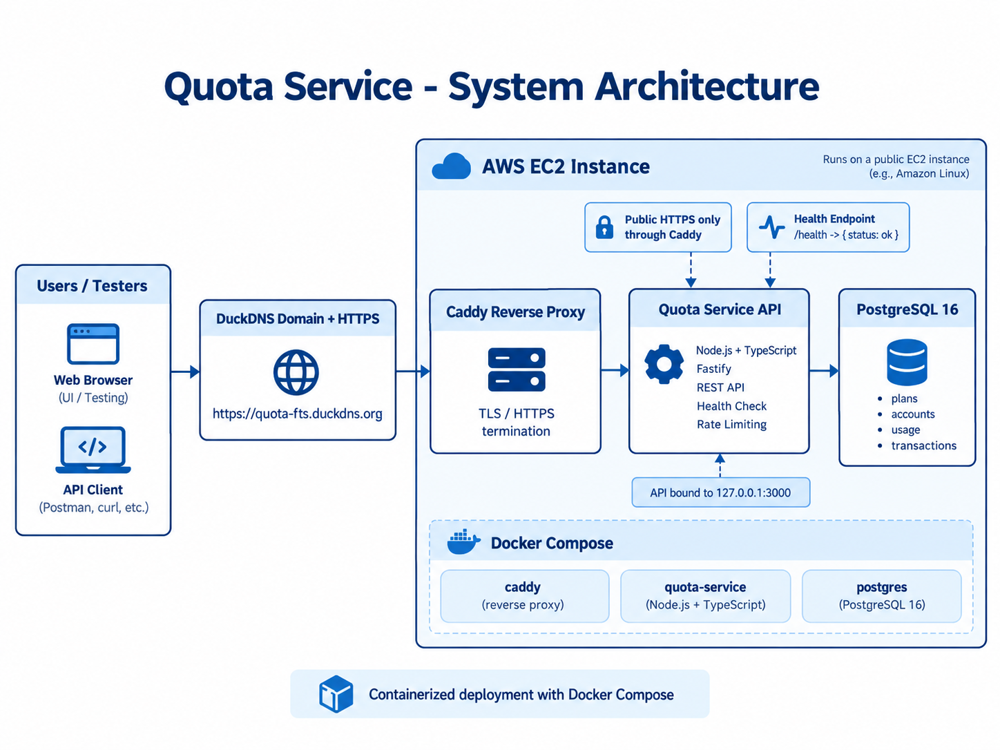
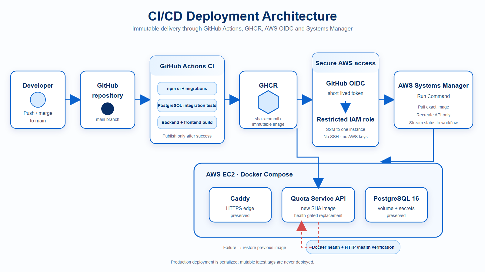
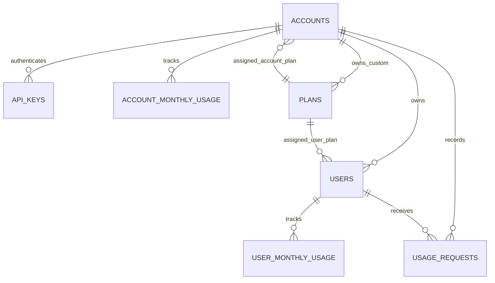

# Usage Metering & Quota Service

<p align="center">
  
  
  
  
  
  
  
  
  
  
  
  
</p>

🔊 Note: This demo includes English voice narration. Please enable your sound for the full experience.

https://github.com/user-attachments/assets/31f52d56-880b-4415-92b3-346ebdecd9dd

▶️ [Watch the Full Demo on YouTube (1080p)](https://youtu.be/u_M7eTvv5NU)

## Table of Contents

Jump directly to a section:

- **Explore:** [Project Overview](#project-overview) · [Live Demo & Links](#live-demo-and-quick-links) · [Core Features](#core-features) · [Technology Stack](#technology-stack)
- **Architecture & Design:** [Architecture](#architecture) · [Engineering Decisions](#engineering-decisions) · [Correctness Guarantees](#critical-correctness-guarantees) · [Database Design](#database-design)
- **Run & Integrate:** [Quick Start](#quick-start) · [Configuration](#configuration-reference) · [API Walkthrough](#api-and-demo-walkthrough) · [API Quick Example](#api-quick-example)
- **Verify & Deploy:** [Testing & Performance](#testing-and-performance) · [Deployment & CI/CD](#deployment-and-cicd) · [Assumptions & Limitations](#assumptions-limitations-and-trade-offs)·[Database Access](#database-access--inspection)

---

## Project Overview

This service lets an application meter usage against two budgets: one monthly allowance shared by the account and one allowance assigned to each user. A request consumes units only when both scopes have enough monthly capacity and both plans permit the request size. Accounts can use predefined or tenant-owned custom plans, change assignments without erasing usage, and inspect every accepted or rejected decision. The central engineering challenge is maintaining correct accounting when requests, retries, and plan changes happen concurrently. PostgreSQL transactions, deterministic row locking, tenant-scoped constraints, and account-scoped idempotency provide those guarantees.

## Live Demo and Quick Links

| Resource | Link |
| --- | --- |
| Live application | [https://quota-fts.duckdns.org](https://quota-fts.duckdns.org) |
| Swagger API documentation | [https://quota-fts.duckdns.org/docs](https://quota-fts.duckdns.org/docs) |
| Professional demo video | Embedded player above |
| GitHub Actions | [CI/CD workflows](https://github.com/FathiHeelo/Usage-Metering-and-Quota-Service-FTS/actions) |
| Postman | [Collection](postman/Usage-Metering-and-Quota-Service.postman_collection.json) · [Example environment](postman/Usage-Metering-and-Quota-Service.postman_environment.json) |

[](https://github.com/FathiHeelo/Usage-Metering-and-Quota-Service-FTS/actions/workflows/ci.yml)
[](https://quota-fts.duckdns.org)
[](https://quota-fts.duckdns.org/docs)

## Core Features

| Capability | Behavior |
| --- | --- |
| Account and user quotas | Every consume request must satisfy both scopes. |
| Predefined and custom plans | Global plans are read-only; custom plans are private to their owning account. |
| Dynamic plan changes | New limits apply to subsequent requests without resetting recorded usage. |
| Atomic consumption | Account usage, user usage, and decision history commit together or roll back together. |
| Idempotent retries | The same account and request ID returns the stored decision without charging twice. |
| Usage history | Accepted and rejected decisions retain immutable limit and counter snapshots. |
| Tenant isolation | API-key authentication supplies account context; clients never choose an account ID. |

## Technology Stack

| Layer | Technologies | Purpose |
| --- | --- | --- |
| Frontend | React, TypeScript, Vite | Interactive dashboard and real-API demo client. |
| Backend | Node.js, Fastify, TypeScript, Zod | REST endpoints, validation, authentication, and quota decisions. |
| Database | PostgreSQL 16, Drizzle ORM | Transactional quotas, durable history, and relational constraints. |
| Testing | Node.js test runner, Playwright, k6 | PostgreSQL integration, browser E2E, and local load tests. |
| Containers & CI/CD | Docker, Docker Compose, GitHub Actions, GHCR | Reproducible builds, automated checks, and immutable images. |
| Cloud & HTTPS | Amazon EC2, AWS Systems Manager, GitHub OIDC, Caddy | Production deployment without stored long-lived AWS keys and HTTPS termination. |

## Architecture

The React dashboard is compiled into the production image and served by Fastify. Caddy terminates HTTPS on the EC2 host, while the API and PostgreSQL run in Docker Compose. PostgreSQL is the consistency boundary for authentication, ownership, plan assignment, counters, and decision history.



The delivery pipeline builds and tests the application, publishes an immutable SHA-tagged image to GHCR, assumes AWS access through GitHub OIDC, and deploys through AWS Systems Manager.



<a id="engineering-decisions"></a>

## Engineering Decisions — Why These Technologies?

| Our Choice | Alternatives Considered | Why It Fits This Problem | Trade-off |
| --- | --- | --- | --- |
| PostgreSQL 16 | Redis, MongoDB | ACID transactions, row locks, foreign keys, uniqueness, and durable relational counters make multi-record quota accounting explicit. Redis can support atomic workflows but durable relational history and multi-record invariants would need additional design; MongoDB supports transactions but is less direct for this relational model. | One database is the scaling boundary, and hot accounts can contend on locks. |
| Fastify | Express, NestJS | Fastify provides a small runtime, plugin boundaries, schema integration, structured logging, and fast request injection for tests. | Express has a larger ecosystem; NestJS provides stronger conventions for a larger team but adds framework structure this service does not need. |
| Drizzle ORM | Prisma, raw SQL | Drizzle gives TypeScript-safe schema/query construction while leaving PostgreSQL transactions, `FOR UPDATE`, constraints, and SQL behavior visible. | Some low-level SQL knowledge remains necessary; raw SQL would offer maximum control with less type safety. |
| PostgreSQL row locks | In-process mutexes | Database locks coordinate every API process at the persistence layer. Account-first ordering serializes quota-affecting mutations and prevents cross-user requests from overspending a shared account budget. | Very busy tenants serialize at the account row and may need partitioning or a carefully reconciled accelerator later. |
| Docker Compose | Kubernetes | One API, one PostgreSQL database, and one host fit a one-week take-home while preserving reproducible startup, health ordering, persistence, and networking. | Compose is single-host orchestration and does not provide multi-node scheduling or autoscaling. |
| React + Vite | Next.js or a larger frontend framework | The evaluator needs a small interactive client for real API workflows, not SSR or a complex frontend platform. | Frontend deployment is coupled to the API image. |
| k6 | Ad hoc loops, full observability suites | k6 expresses load stages, concurrent batches, thresholds, and correctness assertions for consumption and idempotency. | Results depend on the local host and scenario; they are evidence, not a universal capacity claim. |

## Critical Correctness Guarantees

1. **Atomic consumption.** The account counter, user counter, and history record are written in one PostgreSQL transaction. A persistence failure leaves all three unchanged.
2. **Concurrency safety.** Quota-affecting work locks the account first, then the user and the relevant monthly usage counter rows; current plans are read after these locks. Concurrent users therefore cannot overspend the same account allowance.
3. **Idempotency.** `(account_id, request_id)` is unique. An identical retry returns the stored decision; reusing the ID with a different user or units returns HTTP `409`.
4. **Dynamic plans.** Assignment and custom-limit updates share the account serialization point with consumption. A later request sees one coherent plan version, while already consumed units remain intact.

Example: an account has 50 units remaining, and a user has 20. A 10-unit request passes both checks and advances both counters by 10. A later 15-unit request can still fit the account but is rejected if the user has only 10 left; neither counter changes.

A quota rejection is an expected business decision, so `POST /usage/consume` returns HTTP `200` with `accepted: false` and a rejection reason. An idempotency payload conflict is a misuse of an existing request identity and returns HTTP `409`.

## Database Design

The seven tables separate identity, plan configuration, mutable monthly counters, and immutable decision evidence:

| Table | Purpose |
| --- | --- |
| `plans` | Predefined plans and tenant-owned custom ACCOUNT/USER plans. |
| `accounts` | Tenant identity and current ACCOUNT plan assignment. |
| `api_keys` | SHA-256 API-key hashes, non-secret prefixes, revocation, and last-use metadata. |
| `users` | Tenant-scoped external users and current USER plan assignments. |
| `account_monthly_usage` | One counter per account and UTC month. |
| `user_monthly_usage` | One counter per user and UTC month. |
| `usage_requests` | Idempotency record plus decision-time plan and counter snapshots. |



## Database Access & Inspection

The service uses PostgreSQL 16 with Drizzle ORM for schema management and database operations.

The database runs inside Docker Compose and is intentionally not exposed to the public internet.

### Inspect the Local Database

Start the application:

```bash
docker compose up -d --build
```

Connect to PostgreSQL using the default development credentials:

```bash
docker compose exec postgres psql -U quota_user -d quota_db
```

List all database tables:

```sql
\dt
```

Inspect the data:

```sql
SELECT * FROM plans LIMIT 10;
SELECT * FROM accounts LIMIT 10;
SELECT * FROM users LIMIT 10;
SELECT * FROM account_monthly_usage LIMIT 10;
SELECT * FROM user_monthly_usage LIMIT 10;
SELECT * FROM usage_requests LIMIT 10;
```

Exit PostgreSQL:

```sql
\q
```

If you changed the credentials in `.env`, use your configured PostgreSQL username and database name.

### Schema and Database Tools

- [Database Schema](src/db/schema.ts)
- [Drizzle Migrations](drizzle/)
- [Database ERD](docs/assets/database-erd.png)
- [Drizzle Configuration](drizzle.config.ts)

The project also provides `npm run db:studio` for Drizzle Studio when PostgreSQL is accessible from the local development environment.

**Security:** Production PostgreSQL is private and is not publicly exposed. Evaluators should inspect their own local Docker database rather than connecting directly to production.

Important constraints include tenant-scoped user uniqueness, account-scoped request IDs, composite account/user foreign keys, first-of-month counter keys, and ownership rules distinguishing predefined from custom plans.

## Quick Start

Prerequisites: Docker with Compose and an available local port `3000`.

```bash
cp .env.example .env
docker compose up --build
```

On Windows PowerShell:

```powershell
Copy-Item .env.example .env
docker compose up --build
```

Compose starts PostgreSQL 16, waits for database health, builds the server and dashboard, applies migrations, seeds predefined plans, and serves:

- Dashboard: [http://localhost:3000](http://localhost:3000)
- Health: [http://localhost:3000/health](http://localhost:3000/health)
- Swagger UI: [http://localhost:3000/docs](http://localhost:3000/docs)

Stop safely with `docker compose down`. The named PostgreSQL volume remains intact. Do not add `-v` unless deleting local data is intentional.

## Configuration Reference

The [`.env.example`](.env.example) file documents the local defaults. Copy it to `.env` for development; do **not** commit real credentials. Docker Compose injects the API's internal PostgreSQL URL from the `POSTGRES_*` values.

| Variable | Local default | Purpose |
| --- | --- | --- |
| `PORT` | `3000` | Host port for the API and dashboard; the container listens on port `3000`. |
| `POSTGRES_DB` | `quota_db` | Local PostgreSQL database name. |
| `POSTGRES_USER` | `quota_user` | Local PostgreSQL username. |
| `POSTGRES_PASSWORD` | `quota_password` | Development-only PostgreSQL password; replace outside local development. |
| `DATABASE_URL` | See `.env.example` | Used when running the Node.js app or migrations outside Compose; Compose supplies an internal database URL to the API service. |
| `DB_POOL_MAX` | `10` | Maximum PostgreSQL connections in the API connection pool. |
| `ACCOUNT_CREATION_RATE_LIMIT_MAX` | `3` | Maximum allowed `POST /accounts` requests per client IP during the configured window. |
| `ACCOUNT_CREATION_RATE_LIMIT_WINDOW_MS` | `900000` | Rate-limit window in milliseconds (15 minutes). |
| `TRUSTED_PROXY_IPS` | Empty | Comma-separated trusted proxy IP addresses or CIDR ranges; leave empty without a trusted reverse proxy. |
| `API_IMAGE` | `usage-metering-and-quota-service:local` | Compose image selection; production deployment uses immutable GHCR SHA tags. |

`POSTGRES_PORT` is present in `.env.example` but is not used to publish a host-side PostgreSQL port in the current Compose file. PostgreSQL remains on the internal Compose network. See [CI/CD setup](docs/CI-CD-SETUP.md) for production-specific configuration.

## API and Demo Walkthrough

| Method | Endpoint | Purpose |
| --- | --- | --- |
| `GET` | `/health` | Public health check. |
| `POST` | `/accounts` | Create an account and return its raw API key once. |
| `GET` | `/me` | Authenticated account and authoritative `currentPlan`. |
| `PATCH` | `/account/plan` | Assign an accessible ACCOUNT plan. |
| `POST` | `/users` | Create a user under the authenticated account. |
| `PATCH` | `/users/:externalUserId/plan` | Assign an accessible USER plan. |
| `GET/POST` | `/plans` | List available plans or create a custom plan. |
| `PATCH` | `/plans/:planId` | Update an owned custom plan. |
| `POST` | `/usage/consume` | Make an atomic, idempotent quota decision. |
| `GET` | `/usage/account` | Read account usage and its current plan. |
| `GET` | `/usage/users/:externalUserId` | Read tenant-scoped user usage and its current plan. |
| `GET` | `/usage/history` | Read paginated, filterable decision history. |

Active plan identity is explicit rather than inferred from allowance values:

```json
{
  "accountId": "f4f734c2-ff65-4aac-9da9-64583c476c92",
  "month": "2026-10",
  "used": "125",
  "monthlyLimit": "10000",
  "remaining": "9875",
  "currentPlan": {
    "id": "8d040520-a733-436b-b16a-652f59a38345",
    "name": "Starter",
    "scope": "ACCOUNT",
    "monthlyAllowance": "10000",
    "maxUnitsPerRequest": "100"
  }
}
```

Evaluator scenario:

1. Create an account and save the one-time API key.
2. Create two users, then assign a restrictive USER plan to one and a larger USER plan to the other.
3. Assign a small custom ACCOUNT plan.
4. Submit an accepted request for the first user.
5. Use fresh request IDs to demonstrate a USER-limit rejection and an ACCOUNT-limit rejection.
6. Increase the relevant custom-plan limit, then submit a **new** request ID to observe the new decision.
7. Retry that accepted request with the identical ID, user, and units; usage does not increase twice.
8. Open request history to inspect accepted/rejected snapshots.

Retries of an existing request always return its original stored decision. Testing a new plan configuration therefore requires a fresh request ID.

## API Quick Example

This minimal end-to-end example uses the local Docker endpoint. It creates a **new** account, then authenticates to create a user, consumes units, and retries the same request. Use Bash or Git Bash; on Windows you can also use the supplied [Postman collection](postman/Usage-Metering-and-Quota-Service.postman_collection.json).

**1. Create an account and receive its one-time API key:**

```bash
BASE_URL="http://localhost:3000"
curl -i -X POST "$BASE_URL/accounts" \
  -H "Content-Type: application/json" \
  -d '{"name":"README Demo Organization"}'
```

The `201 Created` response contains an `account` object and an `apiKey` string. Save the key locally; it will **not** be returned again. Never commit, share, or screenshot the real key.

**2. Authenticate, create a user, and consume units:**

```bash
API_KEY="paste-your-new-api-key-here"  # Local shell only; never commit

curl -i -X POST "$BASE_URL/users" \
  -H "x-api-key: $API_KEY" \
  -H "Content-Type: application/json" \
  -d '{"externalUserId":"user_001"}'

curl -i -X POST "$BASE_URL/usage/consume" \
  -H "x-api-key: $API_KEY" \
  -H "Content-Type: application/json" \
  -d '{"userId":"user_001","units":10,"requestId":"readme-demo-001"}'
```

For a fresh account using the predefined Starter plan and a fresh Basic user, the consume response is:

```json
{
  "accepted": true,
  "requestId": "readme-demo-001",
  "units": "10",
  "account": { "used": "10", "remaining": "9990" },
  "user": { "used": "10", "remaining": "990" }
}
```

**3. Verify idempotency and inspect usage:**

```bash
# Run the exact same consume request again: same decision, no additional charge.
curl -i -X POST "$BASE_URL/usage/consume" \
  -H "x-api-key: $API_KEY" \
  -H "Content-Type: application/json" \
  -d '{"userId":"user_001","units":10,"requestId":"readme-demo-001"}'

curl -sS "$BASE_URL/usage/account" -H "x-api-key: $API_KEY"
curl -sS "$BASE_URL/usage/history" -H "x-api-key: $API_KEY"
```

The exact retry returns the **original** decision without incrementing counters or adding a duplicate history entry. Reusing the same request ID with different units or a different user instead returns HTTP `409`. For a **new** consumption, use a **new** request ID. For additional request and response examples, see [Swagger](https://quota-fts.duckdns.org/docs) and [Postman](postman/Usage-Metering-and-Quota-Service.postman_collection.json).

## Testing and Performance

The backend uses real-PostgreSQL integration tests for authentication, ownership, plan changes, atomic consumption, lock ordering, idempotency, history, and edge cases. The browser smoke test drives the real React UI and API against an ephemeral PostgreSQL 16 container stored in `tmpfs`; it does not use the development volume.

```bash
npm run test:active-plans
npm run test:updated-at
npm run test:openapi
npm run test:e2e
```

Install Chromium once after dependencies with `npx playwright install chromium`. `npm run test:e2e` then creates, migrates, seeds, uses, and removes its disposable database automatically; traces, screenshots, and video are disabled so API keys cannot enter artifacts.

Verified k6 summaries are committed under [`load-tests/results/verified/`](load-tests/results/verified/). All measurements below are from local Docker Compose on October 15, 2026, not AWS.

| Profile | Workload | Requests / RPS | p95 latency | Technical failures | Correctness evidence |
| --- | --- | ---: | ---: | ---: | --- |
| Smoke | 5 iterations, 1 VU | 14 / 73.86 | 23.98 ms | 0 | 5 accepted; account/user usage 10/10 |
| Quota concurrency | 20 simultaneous requests | 29 / 106.97 | 71.99 ms | 0 | 5 accepted, 15 valid rejections; final usage 50 |
| Concurrent idempotency | 20 simultaneous retries plus one conflict | 30 / 182.29 | 61.96 ms | 0 | One 7-unit charge; one expected conflict |
| Normal load | Ramp to 10 VUs, hold 30 s | 1,795 / 35.77 | 116.32 ms | 0 | 1,786 accepted; counters consistent |
| Controlled stress | Stages at 10, 25, and 50 VUs | 5,319 / 132.72 | 279.34 ms | 0 | 5,310 accepted; counters consistent |

RPS includes fixture and verification traffic. The controlled-stress result is the throughput of that scenario, not a measured maximum capacity. See the [verified results notes](load-tests/results/README.md) for exact JSON evidence and interpretation.

## Deployment and CI/CD

The implemented path is:

`GitHub push → integration tests → production build → GHCR SHA image → GitHub OIDC → AWS SSM → EC2 Docker Compose → HTTPS health check`

- CI runs migrations, seeding, TypeScript/client builds, and PostgreSQL integration tests.
- Images are published with immutable `sha-<commit>` tags.
- GitHub assumes an AWS IAM role through OIDC; no long-lived AWS key is stored in GitHub.
- AWS Systems Manager updates the API service on EC2 without recreating PostgreSQL or its volume.
- Caddy provides the public HTTPS boundary and proxies to the loopback-bound API.
- The deployment script retains the previous image and implements rollback when post-deploy health verification fails. Rollback behavior is implemented but is not claimed as experimentally exercised.

Detailed setup and operational procedures are in [docs/CI-CD-SETUP.md](docs/CI-CD-SETUP.md).

## Assumptions, Limitations, and Trade-offs

- The service meters one generic `units` resource rather than multiple resource types.
- Months are UTC calendar months; the transaction uses the month captured when consumption begins.
- Request IDs are unique per account. Identical reuse returns the original decision; conflicting reuse returns `409`.
- Rejection priority is deterministic: account checks precede user checks.
- Account-first locking favors correctness and simple reasoning over maximum throughput for a single hot tenant.
- The deployment is intentionally single-host Docker Compose, without autoscaling or multi-region failover.
- The dashboard stores the raw demo API key only in browser session storage. This is evaluation-oriented convenience, not enterprise identity management.
- Enterprise monitoring, automated backups, key-lifecycle endpoints, and retention policies are outside the assignment scope.

Long-form transaction notes, the [historical October 15, 2026 audit and post-audit resolution summary](docs/FINAL_AUDIT_REPORT.md), and operating details remain available in [docs/ENGINEERING-NOTES.md](docs/ENGINEERING-NOTES.md) and [docs/CI-CD-SETUP.md](docs/CI-CD-SETUP.md).
